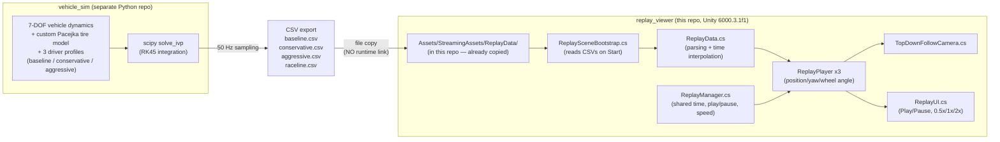

# replay_viewer


**Unity 3D replay visualizer** — plays back the 50 Hz CSV logs produced
by a separate Python project, `vehicle_sim`, reconstructing three driver
profiles (baseline / conservative / aggressive) side by side on the same
track in 3D.

> **This is not a co-simulation.** The Python side fully solves the
> physics ahead of time and writes it to CSV; Unity does not run any
> physics at all — it only **replays** the recorded data by interpolating
> against a shared timestamp. Python and Unity never talk to each other
> at runtime.

## Table of Contents
- [Architecture](#architecture)
- [Setup & Running](#setup--running)
- [Code Structure](#code-structure)
- [Coordinate Conversion](#coordinate-conversion)
- [Dependencies](#dependencies)
- [License](#license)
- [References](#references)
- [Attribution](#attribution)

## Architecture

This project is the Unity side of the following two-repo replay
architecture:



The Python side solves the physics and writes it to CSV; the Unity side
only reads that CSV and **replays it in sync** — all three cars are
sampled against one shared `ReplayManager.CurrentTime`, so they stay
time-aligned (even though each log has its own duration — playback ends
once the longest one finishes).

## Setup & Running

1. **Unity Hub** → **Add** → select this folder (`replay_viewer/`).
   Hub reads **Unity 6000.3.1f1** from
   `ProjectSettings/ProjectVersion.txt` and lists the project under that
   version (install it, or a compatible one, if you don't have it).
2. Open the project. The CSVs already live under
   `Assets/StreamingAssets/ReplayData/`, so no extra data-copy step is
   needed.
3. From the top menu, run **ReplayViewer → Build Replay Scene**. This
   builds `Assets/Scenes/ReplayViewer.unity` from scratch: a ground/road
   ribbon, the raceline centerline, 3 colored cars (red = baseline,
   blue = conservative, green = aggressive), a top-down follow camera,
   and the Play/Pause/speed UI.
4. Hit **Play**. All three cars move in sync against a shared time
   stamp, driven by their own CSV; use the UI to pause or pick
   0.5x/1x/2x speed.

### Updating and re-watching a new simulation run

Re-run `vehicle_sim/run_all.py`, copy the resulting `baseline.csv`,
`conservative.csv`, `aggressive.csv`, `raceline.csv` over
`Assets/StreamingAssets/ReplayData/`, then run **ReplayViewer → Build
Replay Scene** again (no recompile needed — CSVs are read at runtime by
`ReplaySceneBootstrap`).

## Code Structure

| File | Responsibility |
|---|---|
| `Assets/ReplayViewer/Scripts/ReplayData.cs` | CSV parsing + time interpolation (linear position, shortest-path angle via `Mathf.LerpAngle`). |
| `Assets/ReplayViewer/Scripts/ReplayPlayer.cs` | Updates a single car; rotates its front-wheel visuals by the steering angle. |
| `Assets/ReplayViewer/Scripts/ReplayManager.cs` | Single source of truth for shared playback time (`CurrentTime`), play/pause and speed multiplier; feeds every `ReplayPlayer` a synced timestamp each frame. |
| `Assets/ReplayViewer/Scripts/ReplaySceneBootstrap.cs` | On `Start()`, reads the CSVs from `StreamingAssets/ReplayData/` and loads them into the `ReplayPlayer`s (runtime-only, since the CSV isn't a serializable Unity asset). |
| `Assets/ReplayViewer/Scripts/TopDownFollowCamera.cs` | Top-down camera that frames all three cars, dynamically sizing its orthographic view by their spread (can also switch to an optional perspective "chase camera" mode via `useChaseMode`). |
| `Assets/ReplayViewer/Scripts/ReplayUI.cs` | Legacy-UGUI control panel: Play/Pause + speed buttons + time readout. |
| `Assets/ReplayViewer/Editor/ReplayViewerSetup.cs` | **ReplayViewer → Build Replay Scene** menu command: builds the road ribbon, raceline, 3 cars, camera and UI in code, in one click, and saves the scene. |

## Coordinate Conversion

CSV: `x` (world forward), `y` (world left), `yaw_deg` (math convention,
CCW from +x axis). Unity: X-right, Y-up, Z-forward (left-handed).
Conversion (inside `ReplayData.Sample`):

```
unity.x = csv.x
unity.z = csv.y
unity.y = 0
unity_yaw_euler_y = 90 - csv.yaw_deg
```

## Dependencies

This repo is **self-contained and runs standalone**: the four CSVs under
`Assets/StreamingAssets/ReplayData/` (`baseline.csv`, `conservative.csv`,
`aggressive.csv`, `raceline.csv`) are already copied into this
repository — you do **not** need to clone `vehicle_sim` just to watch the
replay.

The only reason you'd need the `vehicle_sim` repo is to **run a new
simulation and refresh the CSVs**. That's a separate, independent Python
project (7-DOF vehicle dynamics + a custom Pacejka tire model + 3 driver
profiles) that produces these CSVs. The two repos are linked only by a
file format (the CSV schema), not by any runtime dependency — each can
be published/cloned on its own.

**Unity packages** (`Packages/manifest.json`): only Unity's own standard
modules are used (`com.unity.ugui`, `com.unity.modules.*`). There is
**no** third-party package — so there's no copyleft-license risk either.

## License

The original C# code under `Assets/ReplayViewer/` and this repo's own
files are **MIT**-licensed — see [`LICENSE`](LICENSE).

**Important:** this license applies **only** to the code in this repo.
The **Unity Editor itself** and the `com.unity.*` packages in
`Packages/manifest.json` are governed by Unity's own license (the Unity
Software/Package EULA) and are not covered or relicensed by this MIT
license.

## References

| Source | Used for |
|---|---|
| [Unity Manual — StreamingAssets](https://docs.unity3d.com/Manual/StreamingAssets.html) | Approach for reading external data (CSV) at runtime |
| [Unity Manual — ScriptableObject vs runtime data](https://docs.unity3d.com/Manual/class-ScriptableObject.html) | Rationale for loading the CSV at runtime rather than editor-time |
| `vehicle_sim` (separate repo, same author's portfolio) | The Python 7-DOF vehicle-dynamics simulation that produces the CSVs this project reads |

## Attribution

The concept behind this project (Simulink physics → 3D-engine replay)
was inspired by driver-behavior replay content shared on Instagram by
**[@veer.alak.sim](https://www.instagram.com/veer.alak.sim)**, who uses
MATLAB/Simulink together with **Unreal Engine**. This project keeps the
whole stack open-source, using **Python** instead of Simulink for the
physics and **Unity** instead of Unreal Engine for the 3D replay
visualization.
