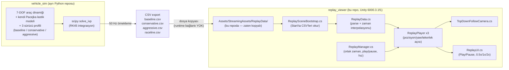

# replay_viewer


**Unity 3D replay görselleştirici** — `vehicle_sim` adlı ayrı bir Python
projesinin ürettiği 50 Hz CSV loglarını, 3 sürücü profilini (baseline /
conservative / aggressive) aynı pistte yan yana oynatarak 3D olarak
yeniden canlandırır (replay).

> **Bu bir co-simulation değildir.** Python tarafı fiziği önceden tamamen
> çözer ve CSV'ye yazar; Unity hiçbir fizik hesaplamıyor, sadece
> kaydedilmiş veriyi zaman damgasına göre **interpolasyonla oynatıyor**
> (replay). Python ve Unity çalışma zamanında birbiriyle konuşmaz.

## İçindekiler
- [Mimari](#mimari)
- [Kurulum ve Çalıştırma](#kurulum-ve-çalıştırma)
- [Kod Yapısı](#kod-yapısı)
- [Koordinat Dönüşümü](#koordinat-dönüşümü)
- [Bağımlılıklar](#bağımlılıklar)
- [Lisans](#lisans)
- [Kaynakça / References](#kaynakça--references)
- [Attribution](#attribution)

## Mimari

Bu proje, aşağıdaki iki-depo (two-repo) replay mimarisinin Unity tarafıdır:



Python tarafı fiziği çözer ve CSV'ye yazar; Unity tarafı sadece bu CSV'yi
okuyup ekranda **senkron şekilde yeniden oynatır** — üç araç da ortak bir
`ReplayManager.CurrentTime` damgasına göre örneklendiği için birbirleriyle
zaman içinde hizalı kalır (her birinin kendi log süresi farklı olsa da, en
uzun sürene göre biter).

## Kurulum ve Çalıştırma

1. **Unity Hub** → **Add** → bu klasörü (`replay_viewer/`) seç.
   Hub, `ProjectSettings/ProjectVersion.txt`'den **Unity 6000.3.1f1**'i
   okuyup projeyi o sürümle listeler (yoksa bu sürümü/uyumlu bir sürümü
   kurmanız gerekir).
2. Projeyi aç. CSV'ler zaten `Assets/StreamingAssets/ReplayData/` altında
   hazır olduğu için ekstra bir veri kopyalama adımı gerekmez.
3. Üst menüden **ReplayViewer → Build Replay Scene**'i çalıştır. Bu,
   `Assets/Scenes/ReplayViewer.unity` sahnesini sıfırdan kurar: zemin/yol
   şeridi, raceline merkez çizgisi, 3 renkli araç (kırmızı=baseline,
   mavi=conservative, yeşil=aggressive), üstten-takip kamerası ve
   Play/Pause/hız UI'ı.
4. **Play**'e bas. Üç araç kendi CSV'sine göre, ortak bir zaman
   damgasıyla senkron hareket eder; UI'dan durdurabilir, 0.5x/1x/2x hız
   seçebilirsin.

### Simülasyonu güncelleyip yeniden oynatmak için

`vehicle_sim/run_all.py`'yi tekrar çalıştır, çıkan `baseline.csv`,
`conservative.csv`, `aggressive.csv`, `raceline.csv` dosyalarını
`Assets/StreamingAssets/ReplayData/` üzerine kopyala, sonra **ReplayViewer
→ Build Replay Scene**'i tekrar çalıştır (CSV'ler runtime'da
`ReplaySceneBootstrap` tarafından okunduğu için kod derlemeye gerek yok).

## Kod Yapısı

| Dosya | Sorumluluk |
|---|---|
| `Assets/ReplayViewer/Scripts/ReplayData.cs` | CSV parse + zaman interpolasyonu (pozisyon lineer, açı `Mathf.LerpAngle` ile en kısa yoldan). |
| `Assets/ReplayViewer/Scripts/ReplayPlayer.cs` | Tek bir aracı günceller; ön tekerlek görsellerini direksiyon açısına göre döndürür. |
| `Assets/ReplayViewer/Scripts/ReplayManager.cs` | Ortak oynatma zamanının (`CurrentTime`), play/pause ve hız çarpanının tek kaynağı; tüm `ReplayPlayer`'ları her frame senkronize besler. |
| `Assets/ReplayViewer/Scripts/ReplaySceneBootstrap.cs` | `Start()`'ta CSV'leri `StreamingAssets/ReplayData/`'dan okuyup `ReplayPlayer`'lara yükler (runtime; CSV serileştirilebilir bir asset olmadığı için editor-time yapılamaz). |
| `Assets/ReplayViewer/Scripts/TopDownFollowCamera.cs` | Üç aracı birden çerçeveleyen, aralarındaki mesafeye göre ortho boyutunu dinamik ayarlayan top-down kamera (isteğe bağlı perspektif "chase camera" moduna da geçebilir, `useChaseMode`). |
| `Assets/ReplayViewer/Scripts/ReplayUI.cs` | Play/Pause + hız butonları + zaman göstergesi için legacy-UGUI kontrol paneli. |
| `Assets/ReplayViewer/Editor/ReplayViewerSetup.cs` | **ReplayViewer → Build Replay Scene** menü komutu: tek tıkla yol şeridi, raceline çizgisi, 3 araç, kamera ve UI'ı kodla kurup sahneyi kaydeder. |

## Koordinat Dönüşümü

CSV: `x` (dünya ileri), `y` (dünya sol), `yaw_deg` (matematiksel
konvansiyon, +x ekseninden CCW). Unity: X-sağ, Y-yukarı, Z-ileri
(sol-el). Dönüşüm (`ReplayData.Sample` içinde):

```
unity.x = csv.x
unity.z = csv.y
unity.y = 0
unity_yaw_euler_y = 90 - csv.yaw_deg
```

## Bağımlılıklar

Bu repo **bağımsızdır ve tek başına çalışır**: `Assets/StreamingAssets/ReplayData/`
altındaki dört CSV (`baseline.csv`, `conservative.csv`, `aggressive.csv`,
`raceline.csv`) zaten bu depoya kopyalanmış durumda — `vehicle_sim`
reposunu klonlamanıza **gerek yoktur** sadece replay'i izlemek için.

`vehicle_sim` reposuna ihtiyacınız olan tek durum: **yeni bir simülasyon
çalıştırıp CSV'leri güncellemek** isterseniz. O repo bu CSV'leri üreten
ayrı, bağımsız bir Python projesidir (7-DOF araç dinamiği + kendi Pacejka
lastik modeli + 3 sürücü profili). İki repo birbirine sadece dosya
formatı (CSV şeması) üzerinden bağlıdır, çalışma zamanında bağımlı değildir
— ikisi de ayrı ayrı yayınlanabilir/klonlanabilir.

**Unity paketleri** (`Packages/manifest.json`): yalnızca Unity'nin kendi
standart modülleri (`com.unity.ugui`, `com.unity.modules.*`) kullanılıyor.
Üçüncü parti bir paket **yok** — bu nedenle "bulaşıcı" (copyleft) bir
lisans riski de yok.

## Lisans

`Assets/ReplayViewer/` altındaki özgün C# kodu ve bu reponun kendi
dosyaları **MIT** lisanslıdır — bkz. [`LICENSE`](LICENSE).

**Önemli:** bu lisans **sadece** bu repodaki koda uygulanır. **Unity
Editor'ün kendisi** ve `Packages/manifest.json`'daki `com.unity.*`
paketleri Unity'nin kendi lisansına (Unity Software/Package EULA)
tabidir ve bu MIT lisansı tarafından kapsanmaz/yeniden lisanslanmaz.

## Kaynakça / References

| Kaynak | Kullanım amacı |
|---|---|
| [Unity Manual — StreamingAssets](https://docs.unity3d.com/Manual/StreamingAssets.html) | Runtime'da harici veri (CSV) okuma yaklaşımı |
| [Unity Manual — ScriptableObject vs runtime data](https://docs.unity3d.com/Manual/class-ScriptableObject.html) | CSV'nin editor-time değil runtime'da yüklenme gerekçesi |
| `vehicle_sim` (ayrı repo, bu kullanıcının portföyünde) | Bu projenin okuduğu CSV'leri üreten Python 7-DOF araç dinamiği simülasyonu |

## Attribution

Bu projenin konsepti (Simulink fizik → 3D oyun motorunda replay), Instagram'da
**[@veer.alak.sim](https://www.instagram.com/veer.alak.sim)** hesabının
MATLAB/Simulink + **Unreal Engine** ile paylaştığı araç dinamiği/sürücü
davranışı replay içeriklerinden esinlenilmiştir. Bu projede, teknoloji
yığını tamamen açık kaynak tutulduğu için Simulink yerine **Python**
(fizik), Unreal Engine yerine ise **Unity** (3D replay görselleştirme)
kullanılmıştır.
